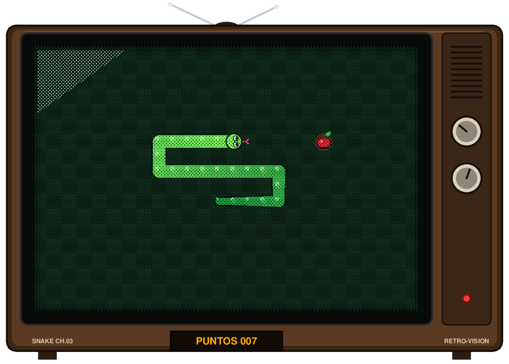
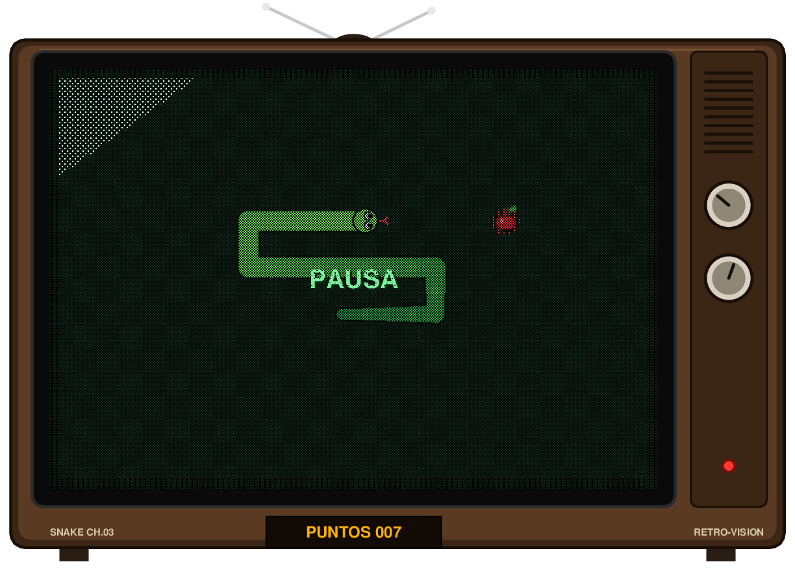
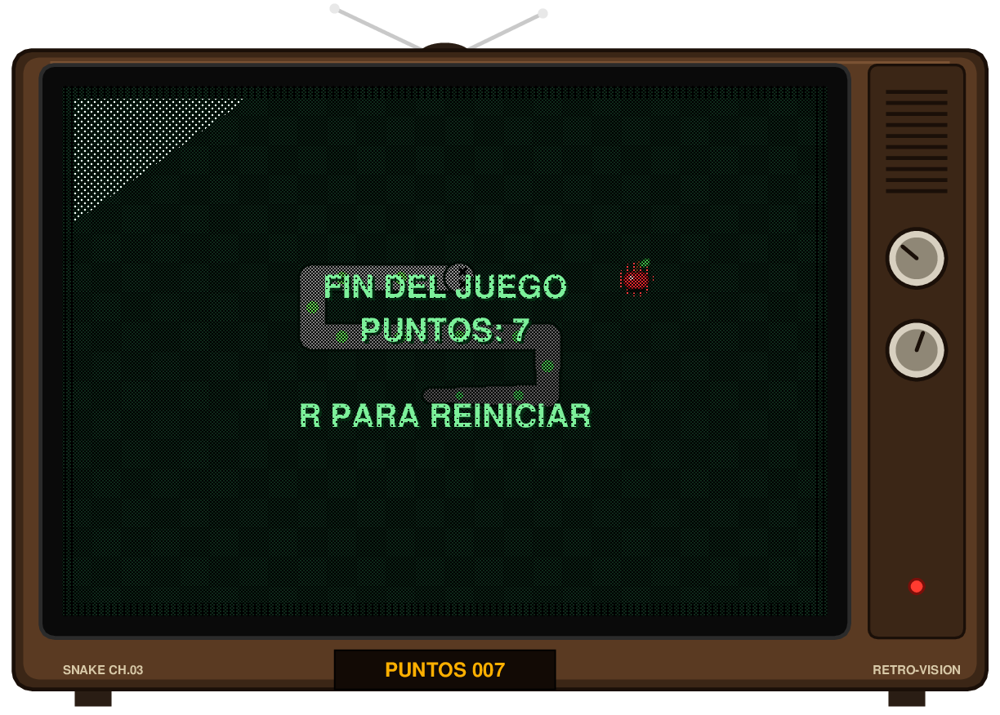

# serpiente-demo

Juego de la serpiente (Snake) en Python con estética de televisor antiguo. Usa solo `tkinter`, que viene incluido con Python, así que no hay que instalar nada.



## Requisitos

- Python 3.8 o superior
- `tkinter` (en Debian/Ubuntu: `sudo apt install python3-tk` si no está disponible)

## Cómo ejecutarlo

```bash
python3 snake.py
```

## Manual de juego

### Objetivo

Guía a la serpiente para comer manzanas. Cada manzana suma **1 punto** y hace crecer a la serpiente. Cuanto más larga, más difícil es no chocar contigo misma.

### Controles

| Tecla | Acción |
|-------|--------|
| `↑` `↓` `←` `→` o `W` `A` `S` `D` | Mover la serpiente |
| `P` | Pausar / reanudar |
| `R` o `Espacio` | Reiniciar (solo tras perder) |

No se puede girar 180° de golpe: por ejemplo, si vas a la derecha no puedes pasar directamente a la izquierda.

### Reglas

- La serpiente avanza sola en la última dirección elegida.
- Pierdes si chocas contra un **borde de la pantalla** o contra **tu propio cuerpo**.
- Si llenas todo el tablero, la partida termina (victoria).
- Tu puntuación se muestra en el marcador ámbar bajo la pantalla.

### Pantallas

| Pausa | Fin del juego |
|:-----:|:-------------:|
|  |  |

Al perder, la serpiente se pone gris y sus ojos se convierten en cruces.

## Personalización

Las constantes están al inicio de `snake.py`:

| Constante | Descripción | Valor por defecto |
|-----------|-------------|-------------------|
| `DELAY` | Milisegundos entre movimientos (menor = más rápido) | `110` |
| `COLS`, `ROWS` | Tamaño del tablero en casillas | `26` × `18` |
| `CELL` | Tamaño de cada casilla en píxeles | `24` |

## Estructura

```
snake.py   # el juego completo
docs/      # capturas usadas en este README
```

> Las capturas de `docs/` se generaron exportando el lienzo a PostScript, por lo que se ven más punteadas (tramadas) que la ventana real.
